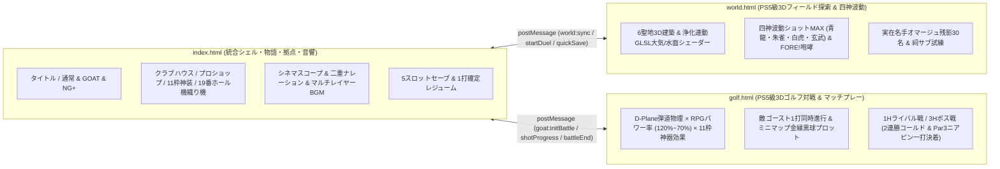
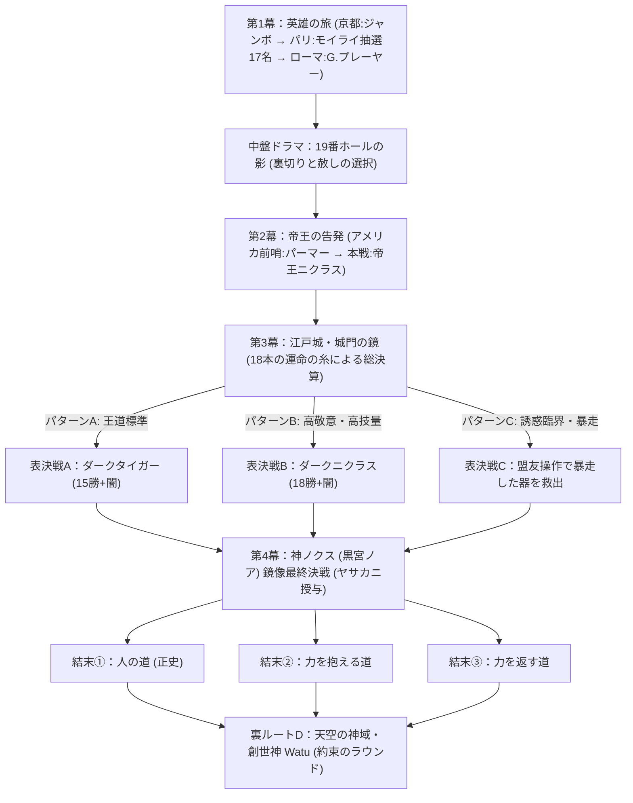

# 『BATTLE OF GOLF - GOAT』完全統合マスター設計書（Master Specification v2.0 Complete）

> **文書の位置づけ（Single Source of Truth）**  
> 本書は `goat_battle_of_golf_anti` 配下の全28設計ドキュメント（v0.1〜v1.0）を精査し、検討過程の旧案・未決定事項・版数間の差異をすべて論理的に解消・統合した**唯一の最終正本（マスター設計書）**である。  
> Webアプリケーションを構成する3ファイル（`index.html` / `world.html` / `golf.html`）のゲームロジック、データ構造、UI/UX、ビジュアル・音響演出はすべて本書を基準とする。

---

## 第0章：全28設計書の統合方針と旧案・未決定事項の最終解決マトリクス

検討過程で生じた旧案および草案段階の「未決定事項」は、後続の決定文書に基づき以下の通り**完全解決・一本化**されている。

| 項目 | 旧案・草案時の仮置き（破棄・上書き済） | 最終決定仕様（本書および実装の正） | 根拠文書 |
|---|---|---|---|
| **ボスの正体と最終ボス** | モンスターボス案（v0.1初期）、中嶋→マッシー→ロッカ→ニクラス→取り憑かれた青木功＝最終ボス案B | **往年の名選手（レジェンド）編成v0.2＋マルチラスボス拡張**。京都＝ジャンボ尾崎、パリ＝モイライ抽選枠、ローマ＝G.プレーヤー、米国＝パーマー→ニクラス2連戦、江戸城＝分岐ラスボス（標準：ダークタイガー）→真最終戦：**神ノクス**。青木功は「闇を封じた神主の末裔（青木会長）」として物語の中核を担う | `boss_roster_v0.2` / `story_patterns_v0.1` / `spec_final_v1.0` |
| **主人公設定** | 黒宮ノア固定主人公案 | **ゴルフ側6人からの選択制＋表示名自由変更**。選んだキャラが「神の器」となり、**「黒宮ノア」は闇の神ノクスの真名**として器に語りかける | `story_v0.3_myth` / `story_patterns_v0.1` |
| **雑魚アクション戦闘** | クラブで敵を直接殴る近接案（v0.1） | **「殴らない、ボールを打つ」四神波動ショットMAX版**。アドレス→溜め3段階→インパクトでボールを打ち、直撃（大威力）＋四神の波動範囲（中威力）で残影を浄化する。密着時のみ緊急振り払い、ピンチ時は「ファー！」で敵を怯ませる | `action_clubs_v0.1(v0.2)` / `action_wave_visual_v0.2_max` / `spec_final_v1.0` |
| **ボール回収ルール** | 未決定（波動のみ命中時の扱い等） | **落下地点回収＋浄化帰還制**。敵を浄化（撃破）すれば手元に自動帰還。外れた球・波動のみ当たった球は落下地点に光球として残り回収可能。**池・OB・谷底への落下時のみロスト**（神器「ヤサカニ」装備時またはGOATモード時は一切失われない） | `spec_final_v1.0` / `artifacts_v0.1` |
| **ボス戦の引き分け扱い** | 未決定（合計スコア→ショットポイント→残りパワーの事務的判定案） | **マッチプレー正式ハーフ＋ニアピン一打勝負プレーオフ**。同スコアのホールは「ハーフ（引き分け）」。3H終了時に勝ち越し側が勝利（2連勝時は即コールド）。**オールスクエア（1勝1敗1分／3分）時のみ「Par3ニアピン一打勝負」**で劇的に決着 | `boss_draw_v0.1` / `spec_final_v1.0` |
| **装備枠とヘッド分離** | ヘッド一体型案・7枠案・消耗品未決定 | **全11枠確定**（ドライバー／アイアン／ウェッジ／パター／シャフト／グリップ／ボール／服／帽子／手袋／シューズ）。ボールはプロショップでのダース買い消耗品。例外特性枠（ゼクシオオ、イオミック、レイングリップ）正式採用 | `gear_slots_v0.2` / `gear_list_v0.1` / `gear_apparel_v0.1` / `gear_numbers_v0.1` |
| **コース割り当て** | 欧州コース不足による日本コース混在（v0.1/v0.2） | **エリア内ライバル／ボス完全分離＋国整合v0.3**。パリはセントアンドリュースのニュー／オールドで分離、ローマは地中海気候読み替え（花葉CC地中海仕様／ペブルビーチ）、米国はペブルビーチ／TPCソーグラス→オーガスタ、日本（京都・江戸城）は戸田／宍戸ヒルズ（江戸は黄泉闇仕様）、神域はオーガスタ神域仕様 | `course_assignment_v0.3` |
| **セーブ方式** | 未決定 | **手動3枠（クラブハウス）＋オート1枠＋クイック1枠（フィールド随時）＋常時ローカルストレージ・レジューム**（対戦中は1ショット確定単位で保存し不正打ち直し防止）。周回引き継ぎはレジェンド図鑑・称号・抽選天井カウンタ | `save_system_v0.1` / `spec_final_v1.0` |

### システム全体アーキテクチャ（3ファイル統合構成）

1. **`index.html`（統合シェル・物語進行・拠点施設・シネマティック演出エンジン）**
   - タイトル画面、モード選択（通常モード／👑GOATモード／周回New Game+）、主人公選択＆名前変更、5スロットセーブ＆常時レジューム管理。
   - 全5エリア＋天空の神域のワールド進行管理、クラブハウス、プロショップ（全67種ギア管理）、11枠装備＆神装共鳴UI、19番ホール（モイライの機織り機「18本の運命の糸」、予想ビンゴ、縁の糸、運試し、レジェンド図鑑、旅の日記）。
   - シネマスコープ（上下黒帯）演出、二重ナレーション（男性＝歴史／女性＝運命）＆英語フック字幕、運命の岐路イベント・誘惑・裏切りイベント「19番ホールの影」・命の選択。
2. **`world.html`（PS5級3Dオープンワールド探索＆四神波動アクションエンジン）**
   - 全5エリア（京都・パリ・ローマ・アメリカ・江戸城）＋天空の神域の固有3Dフィールド生成、浄化度に応じたリアルタイム天候・空・霧・光の回復（天岩戸モチーフ）、マルチレイヤーBGM＆環境音。
   - 残影30名（大12・中12・小6）の象徴3DモデルとAI、四神（青龍・朱雀・白虎・玄武）波動ショットMAX演出、祠・試練ダンジョン・ボール回収・クイックセーブ・額縁フィールドHUD。
3. **`golf.html`（PS5級3Dゴルフ対戦・パワー率物理・マッチプレーエンジン）**
   - D-Plane弾道物理・マグナス効果・グリーン傾斜パット・天候/風/ライ物理を備えた本格3Dゴルフエンジンに、RPGのパワー率（120%〜70%）、全11枠ギア＆神器特殊効果、敵ゴースト同時進行シミュレーション、特殊ショット8種＋絶対ショット、額縁中継HUD（炎のパワーゲージ・糸のメンタルゲージ・敵ボールミニマップ）、2連勝コールド＆Par3ニアピン一打勝負プレーオフを完全統合。

---

## 第1章：世界観・融合神話と創世の編年史

### 1.1 タイトルとテーマ
- **タイトル**: **『BATTLE OF GOLF - GOAT』**（GOAT = *Greatest Of All Time* ／ 史上最高）
- **コアコンセプト**: 世界そのものが神々のラウンドによって創られた大地。RPGの剣や魔法を一切使わず、**「ゴルフの一打」と「人間の英断」**だけで神話の闇を祓い、史上最高（GOAT）の魂へ至るシネマティック3DゴルフRPG。

### 1.2 創世から現代へ至る5つの時代（融合神話：古事記 × オリンポス神話）
1. **創世の時代 ―「最初のラウンド」**:
   - かつて神界には東の**高天原**と西の**オリンポス**という二つの座があった。神々は戦争ではなく**「最初のラウンド」**と呼ばれるゴルフ対決で世界の形を決めた。
   - 神々の放ったスーパーショットの着弾跡が島々となり、ディボットの窪みが海と湖になり、グリーンの跡が豊かな草原となった（国生み×天地創造の融合）。
2. **伝承の時代 ―「プロメテウスの反逆」**:
   - 神々が天へ去る「神去り」の折、神々の聖なる遊戯ゴルフを人間に分け与えた罪で天を追放された神がいた。彼こそが地上を永遠にさすらう放浪者 **Watu** である。彼は「自称ゴルフの神」と嘯きながら、常に人間の可能性を信じて人側に立ち続ける。
3. **神代の戦争 ―「二重の追放者ノクスと三種の神器」**:
   - 神去りの際、高天原からもオリンポスからも追放され地上に取り残された原初の神がいた。ギリシャの夜の女神**ニュクス**と、黄泉国を治める**イザナミ**の闇を併せ持つ**闇の神ノクス（真名：黒宮ノア）**である。
   - 絶対無敗ゆえの永遠の孤独を抱えるノクスは、「敗北の感覚」を知るため、時代ごとの最強ゴルファーを傀儡「ダークチャンピオン」に変えて世界を闇に染める遊戯を繰り返した。
   - 伝説の時代、その人形に人間として挑み退けたのが若き帝王**ジャック・ニクラス**と、封印の神主の血を引く**青木功**の先祖であった。分割された闇の力は**「三種の神器（ヤタノミラー・クサナギ・ヤサカニ）」**に封じられ、江戸城地下の「黄泉の門」に納められた。
4. **闇の時代 ―「天岩戸の再来」**:
   - 現代。さらなる高みへの野心に燃える絶対王者**タイガー・ウッズ**は、ノクスの甘美な予言（マクベスの魔女の囁き）に魅入られ、江戸城地下の黄泉の門を開いてしまう。
   - 世界から「光（ゴルフを愛する心）」が隠れ、聖地は闇の霧と往年の名手たちの迷える「残影」に覆われた。
5. **現在 ―「神の器の旅立ち」**:
   - ノクスは自らの手で自分を打ち負かす可能性を持つ人間を1人選び、密かに自らの神性の欠片を宿らせた――それが主人公**「神の器」**である（主人公が放つ「会心の一撃」は、器から漏れ出る神の力の発露である）。
   - 闇を封じた神主の末裔である**青木会長（Aoky）**は器の正体に気づきながら、神を人の心でもてなす神事として「世界各地の聖地とレジェンドの解放」を託す。

---

## 第2章：物語の4幕構成・人間ドラマ12主題・18本の運命の糸・マルチ分岐

### 2.1 物語の4幕構成

- **第1幕：英雄の旅（京都 → パリ → ローマ）**
  - 京都（天孫降臨の地）で地の王者ジャンボの試練を越え、パリ（モイライの宮廷）で運命の糸が選んだ伝説と邂逅し、ローマ（神代の闘技場）で黒衣の騎士プレーヤーの不屈の闘志を受け継ぐ。この中盤、信頼していた案内人の裏切り「19番ホールの影」が発生する。
- **第2幕：帝王の告発（アメリカ）**
  - プロメテウスの火が受け継がれる新世界。民衆の王パーマーとの熱狂の勝負を経て、オーガスタに立つ「帝王の門番」ニクラスと対峙する。18勝の帝王は主人公が「ノクスの器」であることを公然と告発し、その答え方が物語最大の転換点となる。
- **第3幕：人形との決別（江戸城・黄泉の門）**
  - 青木会長から草薙剣「クサナギ」を授かり、天岩戸が閉ざされた江戸城へ。城門の鏡にここまでの「18本の運命の糸」の集大成が映し出され、パターンA/B/Cに応じた宿命のラスボスを解放（救済）する。
- **第4幕：神対人の鏡像戦（天岩戸の最奥 → エピローグ ／ 裏ルート：天空の神域）**
  - 解放の直後、放浪の神 Watu が現れて最後の神器「ヤサカニ」を託す。器から完全に分離・顕現した**闇の神ノクス（黒宮ノア）**との真の最終決戦（自分自身の選択の投影との鏡像戦）。勝利した器は神の座を拒んで「人の道」を選び、天岩戸が開いて全世界のコースに光が戻る。クリア後には真の姿の Watu が待つ裏ルート「天空の神域・約束のラウンド」が解放される。

### 2.2 世界文学12の人間ドラマ主題の構造移植
テーマは説教や説明台詞ではなく、**出来事・選択・関係の結果**として物語構造に編み込む。

| 主題 | 文学的原型 | 作中での構造と担い手 |
|---|---|---|
| **1. 友情** | 盟友の誓い | 解放したライバルたちとの「絆の糸」。江戸城「決戦前の夜」およびパターンC（仲間が暴走した主人公を救う最終戦）で結実 |
| **2. 裏切り** | 『ジュリアス・シーザー』 | 中盤イベント**「19番ホールの影」**。旅を支えた常連案内人が家族を人質に取られノクスへ情報を売っていた真相の発覚 |
| **3. 愛情** | 無償の愛・民への愛 | パーマーと観衆の相互愛、青木会長の見返りを求めない器への信頼、賞金を人々に還元する「恵みの糸」 |
| **4. 憎悪** | 『オセロー』イアーゴー | ノクスの本質。自ら手を下さず耳元の囁きで英雄の心を蝕む。敗北を知らぬ孤独の裏返しとしての憎悪 |
| **5. 尊敬** | 先行者への畏敬 | 帝王ニクラスへの敬意、敗れたレジェンドの生涯を刻む「レジェンド図鑑」そのものが尊敬の装置 |
| **6. 崇拝** | 王と群衆・神と狂信 | パーマーを包む陽性の歓声と、ノクスを崇める闇の信者の陰性の崇拝の対比 |
| **7. 背徳** | 『ファウスト』悪魔の契約 | 各エリアで囁かれる「ノクスの誘惑」。一時的な圧倒的力を得る代償に器の魂（誘惑の糸）が黒く染まる取引 |
| **8. 欺瞞** | 『マクベス』魔女の予言 | ノクスが歴代王者に見せた「永遠の全盛期」という都合の良い幻影。タイガー闇落ちの悲劇の原因 |
| **9. 英断** | 悲劇王の決断 | 「帝王の告発」への返答、「19番ホールの影」の処遇、最終戦後の力の処遇。物語の頂点は一打ではなく英断に置く |
| **10. 不条理** | 『ドン・キホーテ』 | モイライの糸紡ぎによるランダムな運命と、神の気まぐれに翻弄されながらもティーに立ち続ける人間の尊厳 |
| **11. 野心と転落** | 『マクベス』『リア王』 | 15勝の王者タイガーの飽くなき野心による転落と、18勝の帝王ニクラスが次世代の門番として立つ晩節の対比 |
| **12. 救済と赦し** | 『レ・ミゼラブル』 | ボス戦後の「命の選択（解放）」と裏切り者への赦し。救われた者が決戦やエピローグで別の誰かを救う連鎖 |

### 2.3 18本の運命の糸（ゴルフ18ホール対応・数値非表示の没入設計）
内部的に18軸のフラグ／蓄積値を保持するが、UI上に無粋な数値は一切出さない。19番ホールの**「運命の織物（モイライの機織り機）」**において、18本の糸の**色（漆黒＝闇／白銀＝静謐／翡翠＝慈愛／紅蓮＝情熱／黄金＝神話的覚醒）と張り（弛緩〜強靭な輝き）**として視覚表現する。

1. **記憶の糸**（神代の記憶への接触）
2. **心の糸**（人間としての純粋さ・自我の保持）
3. **大地の糸**（全エリアの残影・祠の浄化達成度）
4. **教えの糸**（若手や後進への技術と心の継承）
5. **恵みの糸**（賞金や力を他者のために使う慈愛）
6. **技の糸**（神力に頼らぬ純粋なゴルフ技術の鍛錬）
7. **運命の糸**（モイライとの縁・予想と受容の姿勢）
8. **声の糸**（世間の名声・観衆の熱狂との共鳴）
9. **影の糸**（正体の秘匿・沈黙の美学）
10. **誇りの糸**（正々堂々たるスポーツマンシップ・騎士道）
11. **絆の糸**（解放したライバル・キャディとの信頼の深さ）
12. **歴史の糸**（レジェンドたちの戦績と伝承への理解）
13. **天空の糸**（英雄の試練・神域へ挑む勇気）
14. **敬意の糸**（偉大な先人・帝王に対する礼節）
15. **誘惑の糸**（ノクスの契約に応じた回数・神性の侵食度）
16. **命の糸**（敗れたボスを「解放」したか「力を奪った」か）
17. **赦しの糸**（裏切りや弱さを受け入れ救済した決断）
18. **光の糸**（天岩戸を開き世界へ取り戻した希望の総量）

### 2.4 全エリア「運命の岐路」・誘惑・裏切り・命の選択イベント一覧

| エリア／時期 | イベント種別 | イベント名 | 選択肢と物語・糸・システムへの影響 |
|---|---|---|---|
| **京都** | 岐路1 | **天孫の祠** | **①拾う**: 記憶の糸が伸びノクスの夢を見る（会心率微増＋神性上昇） **②封をして立ち去る**: 心の糸と大地の糸が守られ祠の加護を得る（メンタル最大値+10） |
| **京都** | 岐路2 | **若手の頼み** | **①稽古をつける**: 教えの糸・恵みの糸が育ち、終盤に応援駆けつけ支援発生 **②断って修行に充てる**: 技の糸が伸び、ツアーポイント+120獲得 |
| **京都** | ノクスの誘惑 | **王者の飛距離** | **①力を借りる**: 次のボス戦で飛距離+12%ボーナス、誘惑の糸が濃くなる **②拒絶する**: 心の糸・誇りの糸が強まる |
| **パリ** | 岐路1 | **予想の宣言** | **①真剣に推理して1人宣言**: 運命の糸が張り、的中時に賞金+15,000＆称号「運命を読む者」 **②運命に委ねる**: モイライの好感度が上がり「縁の糸」を1本授かる |
| **パリ** | 岐路2 | **宮廷の詩人** | **①旅を語って聞かせる**: 声の糸が広がり賞金報酬+10%になるが影の糸は緩む **②静かに断る**: 影の糸が張り、メンタル消費軽減+5%の静寂を得る |
| **パリ** | ノクスの誘惑 | **宮廷の主の欠片** | **①味わう**: 次のボス戦で相手初期パワー−20、誘惑の糸が濃くなる **②拒絶する**: 心の糸・敬意の糸が強まる |
| **ローマ** | 岐路1 | **敗れた闘士** | **①手を貸して介抱する**: 誇りの糸・絆の糸が育ち、江戸城決戦前に加勢イベント **②戦いに集中して進む**: 技の糸・歴史の糸が伸び、ツアーポイント+250 |
| **ローマ** | 岐路2 | **英雄の近道** | **①危険な近道（連戦試練）に挑む**: 天空の糸が大きく動き、勝利で英雄の遺物**「アキレスの靴」**入手 **②正攻法で祠を清める**: 大地の糸が着実に晴れ、パワー最大値補強 |
| **ローマ** | ノクスの誘惑 | **騎士の不死身の体** | **①借り受ける**: 次のボス戦でミス時パワー減少半減、誘惑の糸が濃くなる **②拒絶する**: 心の糸・誇りの糸が強まる |
| **中盤（ローマ後）** | 特別ドラマ | **19番ホールの影（裏切り）** | 案内役の常連がノクス信者に脅され情報を売っていたと発覚。 **①赦して家族を救出する**（絆・心の糸高で解放）: 赦しの糸が黄金に輝き、後に貴重な神器ヒントと支援をもたらす **②静かに赦し立ち去らせる**: 赦しの糸・心の糸が育つ **③断罪して追放する**: 影の糸・誘惑の糸が荒れ、孤独と引き換えに攻撃力が上がる |
| **アメリカ** | 岐路1 | **熱狂の観衆** | **①応えて観衆を煽る**: 声の糸が最大化し会心ダメージ増、誇りの糸は少し荒れる **②静かに一打の実力で応える**: 敬意の糸・技の糸が深く結ばれる |
| **アメリカ** | 最大の岐路2 | **帝王の告発** | ニクラスに「お前は闇の神の器だ」と突きつけられる。 **①正面から認め、人の心で超えると誓う**: 心の糸・英断が輝き王道（AまたはB）へ **②否定し、言葉を拒む**: 影の糸が張り詰め緊張の展開へ **③黙して一打で示す**: 技の糸と敬意の糸が極まり、ニクラス戦好成績で**パターンB（帝王の影）**条件を満たす |
| **アメリカ** | 最大の誘惑 | **帝王を超える一打** | **①契約に応じる**: ニクラス戦で絶対的な飛距離を得るが、誘惑の糸が臨界を超え**パターンC（器の暴走）**の引き金となる **②自らの腕で挑む**: 心の糸が確立され暴走を回避 |
| **江戸城** | 岐路1 | **決戦前の夜** | **①最も絆の深い盟友ライバルと過ごす**: 決戦中、ピンチ時にパワー+25の絆支援 **②相棒キャディとコースを読む**: 決戦中、風読みとグリーン傾斜補助強化 **③ひとり静かに日記を綴る**: メンタル最大＋会心ゾーン拡大 |
| **江戸城** | 岐路2 | **城門の鏡** | 選択ではなくこれまでの18本の糸の総決算を鏡に映す儀式。直後に江戸城のラスボス（A/B/C）が確定・顕現する |
| **江戸城** | 最後の誘惑 | **器の座の明け渡し** | **①拒絶して人の意志で立つ**: 最終鏡像戦にて「光の糸」覚醒ボーナス **②一瞬迷いながらも踏みとどまる / 呑まれる**: パターンCまたは過酷な鏡像戦へ |
| **全ボス戦後** | 定例選択 | **命の選択** | **①解放する**: 命の糸・絆の糸・敬意の糸が育ち、レジェンドが救済され図鑑エピソード＆固有レプリカ授与、エピローグ再戦に登場 **②力を奪う**: 即座に大量賞金（+40,000）＆攻撃ステータス上昇を得るが、心の糸が黒く染まり該当レジェンドの物語は閉じる |

### 2.5 マルチラスボス分岐（4パターン）とエンディング分岐
アメリカ終了（ニクラス戦決着）時点で、蓄積された糸の状態により江戸城の最終決戦が分岐する。

1. **パターンA「人形の糸」（王道標準）**:
   - **条件**: 標準進行（誘惑の糸が暴走閾値未満、かつパターンB条件未達）。
   - **展開**: 江戸城で**ダークタイガー（闇落ちした15勝の絶対王者）**と3ホール決戦 → 解放後、Watuからヤサカニを授かり、**闇の神ノクス（鏡像戦）**との真の最終決戦へ。
2. **パターンB「帝王の影」（達人・敬意ルート）**:
   - **条件**: 誘惑に頼りすぎず、「帝王の告発」で『黙して一打で示す』または『正面から認める』を選び、ニクラス戦に勝利して神器ヤタノミラーを授かり、敬意の糸・技の糸が高い場合。
   - **展開**: ノクスが「タイガーよりも18勝の帝王こそ最強の人形にふさわしい」と乗り換え、江戸城で**ダークニクラス（18勝の全盛期闇帝王）**が立ちはだかる衝撃展開 → 解放後、**神ノクス**戦へ。
3. **パターンC「器の暴走」（背徳・盟友救出ルート）**:
   - **条件**: ノクスの誘惑に3回以上応じる、または「力を奪う」を重ねて誘惑の糸（神性侵食）が臨界を超えた場合。
   - **展開**: 江戸城門で主人公の肉体がノクスに完全乗っ取りされる！その絶体絶命の瞬間、これまで解放し絆を結んだ**最強の盟友ライバルに操作キャラクターが切り替わり**、暴走した主人公（覚醒ノクス器態）をゴルフ対決で救い出す熱い逆転劇 → 救出後、意識を取り戻した主人公で**神ノクス**との最終決戦へ！
4. **パターンD「裏・約束のラウンド」（本編クリア後・真エンディングルート）**:
   - **条件**: 本編（A/B/Cいずれか）をクリア後、解放される第6エリア「天空の神域」へ進む。
   - **展開**: ゴルフを人間に与えた追放神 **Watu（真の神話形態・プロメテウス）**が、「人間が神の遊戯をどこまで極めたか、最後の約束のラウンドをしよう」とオーガスタ神域仕様で待ち受ける。勝利で真エンディング到達。

- **エンディングの3選択（神ノクス撃破後）**:
  - **① 人の道（正史）**: 神の力を封じ、ひとりの人間ゴルファーとしてツアーのティーグラウンドへ帰る。
  - **② 力を抱える道**: 光と闇の両方を抱え、新たな時代の番人として歩み続ける。
  - **③ 力を返す道**: 神の力を世界中の人々と大地へ分け与え、すべてのコースに永遠の緑と光を取り戻す。

---

## 第3章：登場人物・ボス編成・モイライの運命抽選システム

### 3.1 オマージュ表現方針と主人公6人（兼ライバル5人）
- **表現原則**: 実在選手の肖像（顔写真等）は直接再現せず、**勝負服の象徴カラー・帽子/眼鏡/左打ち等の小物・スイング所作・実績エピソード・オブラート表示名**で敬意をもって表現する。
- **主人公選択と名前変更**: 開始時に6人から1人を選択し、表示名を自由に変更可能（最大12文字、台詞・HUD・図鑑すべてに即時反映）。
- **ライバル自動配置**: 選ばれなかった残り5人は、基礎実力の低い順（エリア進行に合わせた強さ順）に**京都・パリ・ローマ・アメリカ・江戸城の5エリアのライバル（1ホールマッチ）**として1人ずつ自動配置される。勝利するとそのキャラクターが仲間（盟友）として解放され、クラブハウスでいつでも操作キャラを切り替え可能になる（みんゴルVS方式）。

| ID（初期表示名） | オマージュ元 | 称号・役回り | DR速度 | アイアン安定 | アプローチ安定 | パット安定 | 象徴ビジュアル | ライバル登場順基準 |
|---|---|---|---|---|---|---|---|---|
| **Matuya** | 松山英樹 | 静かなる狙撃手（マスターズ覇者） | 80 | 最高に安定 | 最高に安定 | 安定 | 濃紺/白ウェア・白キャップ・端正なトップの間 | 1番手（入門強敵） |
| **DeCham** | B.デシャンボー | 科学者ゴルファー（全米OP 2勝） | 95 | 安定 | 不安定 | 安定 | オレンジ/白ウェア・ハンチング風黒帽・超高速スイング | 2番手（超飛距離型） |
| **McIlro** | R.マキロイ | 北の貴公子（メジャー5勝級） | 90 | 安定 | 安定 | 不安定 | ロイヤルブルー×白パンツ・美しいハイフィニッシュ | 3番手（高弾道飛距離） |
| **Watu** | オリジナル（プロメテウス） | 自称ゴルフの神（放浪の追放神） | 78 | 不安定 | 不安定 | 安定 | 生成り神話衣×金冠キャップ・予測不能の天才肌（※主人公選択時は二重神性演出） | 4番手（トリッキー） |
| **Junbo** | ジャンボ尾崎 | 豪快な地の帝王（国内94勝） | 84 | 安定 | 安定 | 安定 | 鮮やかなオレンジ/青勝負服・豪快なジャンボスイング | 5番手（※京都ボス兼任。重複時はダーク分身） |
| **TIiger** | タイガー・ウッズ | 絶対王者（メジャー15勝） | 88 | 最高に安定 | 最高に安定 | 最高に安定 | サンデーレッド（赤シャツ×黒パンツ×黒帽） | 6番手・最強ライバル（※最終ボス兼任。重複時は鏡像戦） |

### 3.2 エリア別固定ボス編成（海外4大メジャー勝利数基準）

| 順 | エリア | ボス表示名 | 元レジェンド | メジャー実績・格付け根拠 | 登場形態・特徴 | 撃破・解放報酬 |
|---|---|---|---|---|---|---|
| **1** | **京都** | **Junbo**（ダークJunbo） | ジャンボ尾崎 | 海外0勝／**日本ツアー94勝（歴代1位）** | 日本ゴルフ界の「地の王者」。敵対ではなく若き器を試す関門の儀式 | 賞金30,000／TP+800／レプリカ「ジャンボ・マッスル」 |
| **2** | **パリ** | **運命抽選レジェンド** | 下記17名プールから抽選 | **メジャー5〜11勝（＋名誉枠2名）** | 三女神モイライの糸が選んだ宮廷の主。選ばれた人物により町の物語が変化 | 賞金40,000／TP+1,000／オリンポス神器**「アポロンの弓」**＋個人固有報酬 |
| **3** | **ローマ** | **G.Player** | ゲーリー・プレーヤー | **メジャー9勝**（生涯グランドスラム） | 全身黒衣の「黒騎士（ブラックナイト）」。世界を転戦し戦い続ける不屈の番人 | 賞金50,000／TP+1,100／オリンポス神器**「アテナのアイギス」** |
| **4-1** | **アメリカ前哨** | **A.Palmer** | アーノルド・パーマー | **メジャー7勝**（PGA 62勝） | 「ザ・キング」。アーニーズ・アーミーの大歓声ごと器を迎え撃つ民衆の王 | 賞金55,000／TP+1,200／レプリカ「キングス・ブレード」 |
| **4-2** | **アメリカ本戦** | **J.Niklaus** | ジャック・ニクラス | **メジャー18勝（人類史上最多・金熊）** | 「帝王の門番」。神器の守り人の血筋であり、器の正体を告発し真価を問う | 賞金70,000／TP+1,400／三種の神器①**「ヤタノミラー」** |
| **5-1** | **江戸城（表）** | **Dark TIiger**（分岐A） **Dark Niklaus**（分岐B） **暴走した器**（分岐C） | タイガー（15勝）＋闇の力 ニクラス（18勝）＋闇の力 主人公覚醒態 | **メジャー15〜18勝＋ダーク神補正** | 天岩戸の前で糸に操られる最強の傀儡（または暴走した器自身）。救済の決戦 | 賞金80,000／TP+1,500／解放＆Watuより三種の神器③**「ヤサカニ」**授与 |
| **5-2** | **江戸城（真）** | **神ノクス（黒宮ノア）** | ニュクス×イザナミ融合神 | **神話級（グランドスラマー＋神威）** | 器から分離した無敗の闇神。プレイヤー自身の育成と選択を映す真の鏡像戦 | 本編クリア・天岩戸開扉・エンディング＆裏ルート解放 |
| **6** | **天空の神域** | **プロメテウス Watu** | 真の姿のWatu | **創世神話級（裏ボス）** | ゴルフを人に与えた神との「約束のラウンド」。最高難度の真エンディング戦 | 賞金150,000／TP+3,000／限定称号「GOAT ― 史上最高」 |

### 3.3 パリ「モイライのランダム抽選枠」全17名プール完全定義
重みは**メジャー勝利数に比例**（名誉枠は重み3）。数周連続で上位大物（勝数8以上）に未遭遇の場合、周回引き継ぎの**「天井カウンタ」**により大物の重みが周回ごとに+4ずつ上昇し必ず出会える。さらに重み上位（ヘーゲン、ホーガン、ワトソン）抽選時は25%（天井時は100%）で黄金オーラを纏う**「全盛期フォーム（大当たり特別演出・高難度・限定称号つき）」**として降臨する。

| No | 表示名 | 元レジェンド | 国・地域 | メジャー勝数 | 抽選重み | 象徴ビジュアル | パリ宮廷の物語テーマ | 固有報酬（レプリカ／実話図鑑） |
|---|---|---|---|---|---|---|---|---|
| 1 | **W.Hagen** | ウォルター・ヘーゲン | 米国 | 11勝 | 11 | 華麗なタキシード風ベスト＆ツートン靴 | 華麗なるショーマンと貴族の宴 | ザ・ヘイグ特製パター／「花の香りを嗅ぐ余裕」 |
| 2 | **B.Hogan** | ベン・ホーガン | 米国 | 9勝 | 9 | 白いハンチング帽・彫刻の如き完璧な構え | 沈黙の求道者と奇跡の復活劇 | ホーガン・エイペックス鉄／「交通事故からの不死鳥」 |
| 3 | **T.Watson** | トム・ワトソン | 米国 | 8勝 | 8 | リンクスの風を受けるセーターと優しい微笑 | 風と対話するリンクスの魔術師 | リンクス・ウェッジ／「白昼の決闘（ターンベリー）」 |
| 4 | **H.Vardon** | ハリー・バードン | 英（ジャージー） | 7勝 | 7 | 古典ツイードジャケット・オーバーラッピング握り | 近代ゴルフの夜明けと古典の誇り | バードン・ヒッコリーグリップ／「近代グリップの父」 |
| 5 | **B.Jones** | ボビー・ジョーンズ | 米国 | 7勝 | 7 | ネクタイ＆ニッカーボッカーズの完璧な紳士 | 無冠の帝王・アマチュア精神の極致 | カラミティ・ジェーン模造パター／「年間グランドスラムとオーガスタ創設」 |
| 6 | **S.Snead** | サム・スニード | 米国 | 7勝 | 7 | 粋な麦わらストローハット・流麗なリズム | 音楽のように美しい永遠のスイング | スラマー・ウッド／「PGA最多82勝の美技」 |
| 7 | **G.Sarazen** | ジーン・サラゼン | 米国 | 7勝 | 7 | 伝統のニッカーボッカーズ・陽気な威厳 | 世界に轟いた一打と砂の革命 | サラゼン・サンドウェッジ／「世界が聞いたアルバトロス」 |
| 8 | **N.Faldo** | ニック・ファルド | 英国 | 6勝 | 6 | アーガイル柄セーター・鉄仮面の集中力 | 精密機械の規律と揺るがぬ精神 | アイアン・ニック精密シャフト／「スイング改造の執念」 |
| 9 | **L.Trevino** | リー・トレビノ | 米国 | 6勝 | 6 | 鮮やかな赤黒ウェア・笑顔と稲妻のフェード | 逆境を笑い飛ばすメリー・メックス | メリー・フェードグローブ／「落雷すら冗談に変えた男」 |
| 10 | **S.Ballesteros** | セベ・バレステロス | スペイン | 5勝 | 5 | 濃紺セーター・情熱のガッツポーズ | 駐車場からでもパーを取る想像力の芸術 | セベ・マジックウェッジ／「欧州ゴルフを蘇らせた情熱」 |
| 11 | **P.Mickelson** | フィル・ミケルソン | 米国 | 5勝（6勝級） | 5 | 全身黒ウェア・左打ち・親指を立てる微笑 | 「左の壁」を越える大胆不敵な挑戦 | レフティ・ロブウェッジ／「限界なきギャンブルショット」 |
| 12 | **B.Nelson** | バイロン・ネルソン | 米国 | 5勝 | 5 | 端正なクラシックシャツ・機械の如き直進性 | 11連勝の伝説と穏やかな人格者 | アイアン・バイロン／「年間18勝・不滅の11連勝」 |
| 13 | **J.Braid** | ジェイムズ・ブレイド | スコットランド | 5勝 | 5 | 重厚なスコットランド古典装束・長身の威風 | グレート・トリウムバレート（三巨頭）の威厳 | ハイランド・ドライバー／「コース設計の巨匠」 |
| 14 | **J.H.Taylor** | J.H.テイラー | 英国 | 5勝 | 5 | 英国紳士帽・風に負けない低弾道構え | 嵐のリンクスを切り裂く正確無比の鉄 | ブリティッシュ・アイアン／「全英5勝のパイオニア」 |
| 15 | **P.Thomson** | ピーター・トムソン | 豪州 | 5勝 | 5 | 簡素で機能的なウェア・静かなるリンクス巧者 | 南十字星から来た全英の支配者 | サザン・リンクス球／「全英3連覇の冷静」 |
| 16 | **A.Massi** | アルノー・マッシー | フランス | 名誉枠（1勝） | 3 | ベル・エポックの仏国紳士装束・ベレー帽 | **【地元名誉枠】** ベルサイユに還った仏国唯一のメジャー王者 | ラ・ブーリー記念キャップ／「1907年・海を渡った仏国の英雄」 |
| 17 | **C.Roca** | コスタンティーノ・ロッカ | イタリア | 名誉枠（全英2位） | 3 | アズーリブルーの情熱ウェア・劇的な膝つきポーズ | **【欧州名誉枠】** 罪の谷から奇跡を起こした情熱の男 | ヴァレー・オブ・シン記念パター／「セントアンドリュース60ftの奇跡」 |

---

## 第4章：エリア構成と実在コース割り当て（v0.3国加味・完全分離版）

絶対ルール：**同一エリア内でライバル戦（1H）とボス戦（3H）のコースを必ず分離**し、ボス戦はエリアの国・風土に合致する名門コースを割り当てる。

| 順 | エリア（国） | 神話モチーフ | フィールド特徴 | ライバル戦（1H）コース | ボス戦（3H）コース | 天候・環境演出 |
|---|---|---|---|---|---|---|
| **1** | **京都**（日本） | 天孫降臨の地 | 大鳥居・朱塗り神殿・桜吹雪・竹林・蓮池 | **戸田パブリック**（河川敷戦略コース） | **宍戸ヒルズ西コース**（日本オープン開催の国内最高峰） | 宵闇の紫霧→浄化で桜舞う春の陽射し |
| **2** | **パリ**（フランス） | オリンポスの宮廷 | 白亜の大理石宮殿・幾何学庭園・大噴水・モイライの間 | **セントアンドリュース・ニューコース**（欧州リンクス別構成） | **セントアンドリュース・オールドコース**（ゴルフ発祥の聖地リンクス） | 欧州の海風と宮廷の薄靄→浄化で黄金の陽光 |
| **3** | **ローマ**（イタリア） | 神代の闘技場 | コロッセオ大アーチ・糸杉・石柱遺跡・鍛冶炉 | **花葉CC（地中海リゾート仕様）** | **ペブルビーチ（地中海沿岸断崖仕様）** | 闘技場の砂塵と潮風→浄化で紺碧の地中海晴天 |
| **4** | **アメリカ**（米国） | プロメテウスの火 | 白亜のクラブハウス・ツツジ渓谷・クリーク石橋・嵐の祠 | **ペブルビーチ（西海岸前哨戦仕様）** | 前半パーマー：**TPCソーグラス**（17番アイランドグリーン含） 後半ニクラス：**オーガスタ・ナショナル**（アーメンコーナー含） | 熱狂の西海岸→東部の聖地オーガスタの荘厳な光 |
| **5** | **江戸城**（日本） | 黄泉の門と天岩戸 | 巨石垣と天守・黒紫の瘴気・篝火・黄泉の地下祭壇 | **戸田パブリック（黄泉宵闇仕様）** | **宍戸ヒルズ西コース（天岩戸・黄泉決戦仕様）** | 闇と雷鳴の夜→神ノクス撃破で天岩戸が開き夜明けの金光 |
| **6** | **天空の神域**（神界） | 最初のラウンドの座 | 雲海に浮かぶ白金と黄金の神殿・星座の天球 | ―（裏ボス専用領域） | **オーガスタ・ナショナル（天空の神域・黄金仕様）** | 神々しいオーロラと光の柱が降り注ぐ永遠の聖域 |

---

## 第5章：フィールド3Dアクション戦闘（四神波動ショットMAX版＆残影30名）

### 5.1 「殴らない、ボールを打つ」コアアクション
- **統一操作リズム**: ゴルフ対戦と同じく **アドレス（構え・カメラドリーイン）→ 溜め（テイクバック Lv.1 / Lv.2 / Lv.3 MAX）→ インパクト（解放・発射）** でボールを打ち出す。
- **四神波動システム**: 打ったボール自体に直撃判定（大ダメージ）があり、さらに弾道周囲に四神の波動（範囲中ダメージ＝直撃の50%）が発生する。
- **緊急アクション**:
  - **「ファー！（FORE!）」咆哮（Eキー／UIボタン）**: ゴルフの危険コールを叫び、周囲14m以内の全残影を2.2秒間ひるませる音波衝撃波。連続使用すると敵の耐性が上がりクールダウン（8秒→14秒）が伸びる。
  - **密着振り払い（敵が距離2.5m以内でタップ撃ち）**: ボールを消費せずクラブの風圧で敵をノックバックさせる弱い緊急自衛技（ダメージ8）。
- **フィールド物理連動**: 芝・バンカー（砂）・石畳のライによって初速や特殊効果（バンカーからのウェッジ砂煙目くらまし等）が変化し、フィールドの風が朱雀（アイアン）の羽根軌道を流す。

### 5.2 クラブ別・四神波動ビジュアル＆性能定義（MAX版）

| キー | クラブ | 宿る神獣 | 弾道・戦術特性 | ビジュアル・カメラ・音響演出（MAX版） | 基礎直撃威力（Lv1 / Lv2 / Lv3） |
|---|---|---|---|---|---|
| **1** | **ドライバー** | **青龍** | 低く超高速の直線貫通ビーム。長射程・風に強い。開けた地形で複数の残影を一網打尽にする | 白金の芯線に黄金の龍が螺旋を描いて絡みつく極太ビーム。Lv3では画面幅1/3規模の龍頭咆哮＋三重衝撃波リング＋地面に数秒残る光の溝＋命中時に雲を穿つ光の柱 | **25 / 45 / 80**（貫通） |
| **2** | **アイアン** | **朱雀** | 山なりの放物線。壁や段差を越えて攻撃可能。連射性に優れるが風で美しく流される | オーロラ状のリボン軌道が放物線の頂点で無数の炎と光の羽根（5〜9方向）に分裂し舞い降りる | **22 / 40 / 72**（分裂範囲） |
| **3** | **ウェッジ** | **白虎** | 高弾道ロブで頭上へ上がり垂直落下。最速チャージ。**バンカーから打つと砂煙で敵を目くらまし（3秒間攻撃空振り）** | 上空で一瞬静止した球から白銀の光の柱が轟音と共に垂直落下し、着弾点に白虎の爪痕（放射状の閃光亀裂）が走る | **25 / 45 / 80**（着弾爆発AOE 6.5m） |
| **4** | **パター** | **玄武** | 地面を滑る転がし波動。**静音ステルス（周囲の未発覚敵に気づかれない）**、斜面で曲がり、**命中した敵を100%確定で怯ませる** | 音もなく地面に翡翠色の亀甲模様（ヘキサゴン）同心円波紋が広がり、波紋が通った芝生だけが静かに発光する「静の格」 | **20 / 36 / 65**（地上波紋AOE 8.0m＋確定怯み） |

- **神器・特殊色彩変化**:
  - 通常装備：四神固有色＋白金コア
  - 三種の神器（クサナギ等）装備時：**黒と黄金（黒金）の神威オーラ**に変化
  - オリンポス神器（ゼウスの雷霆等）装備時：**蒼い雷光スパーク**が螺旋に重なる
- **溜め3＆会心時の世界反応**: 溜めLv3到達で空が暗転し遠雷が鳴り響く。インパクトの瞬間にBGMが一瞬無音へ落ちてから破裂音が轟き、0.18秒のヒットストップ（会心時は画面全体が波動色に染まるスローモーション）が発生する。
- **ダメージ補正**: `最終ダメージ = 基礎威力 × (1 + 装備同種クラブtier補正) × (会心時 2.0) × (範囲端ヒット時 0.5)`。

### 5.3 残影30名（実在名手オマージュ雑魚モンスター）完全配置・外観表
全員が闇の霧を纏った半透明の「残影」として徘徊し、浄化（HP 0）されると一瞬だけ生前の鮮やかな勝負服の色を取り戻して礼を捧げ、光の粒子となって天へ還る。
- **基礎HP**: 小＝**20** ／ 中＝**40** ／ 大＝**80**
- **エリアHP・報酬倍率**: 京都 `×1.0` → パリ `×1.3` → ローマ `×1.6` → アメリカ `×2.0` → 江戸城 `×2.5`（天空の神域 `×3.0`）
- **獲得報酬（1体あたり）**: ツアーポイント 小10 / 中16 / 大25（×エリア補正）、賞金 小100 / 中180 / 大300（×エリア補正）。

| エリア | 配置No | 残影名 | 階級 | 象徴装束・小物・スイング所作（3D表現） |
|---|---|---|---|---|
| **1. 京都** | 01 | **ガルシヤ** | 小 | スペイン赤黄の差し色ウェア。クラブを軽やかに回す若々しい所作 |
| **1. 京都** | 02 | **スコト** | 小 | アースカラーの端正な装い。波乗りのように軽やかで美しいスイング美 |
| **1. 京都** | 03 | **ナカジマ** | 中 | **眼鏡**が象徴。グレー帽と誠実で黙々とした日本の職人の佇まい |
| **1. 京都** | 04 | **シソ** | 中 | 質素な濃紺ウェア。待機中も絶えず素振りを繰り返す練習の鬼 |
| **1. 京都** | 05 | **スニード** | 大 | **麦わら帽子（ストローハット）**。しなやかで流れるようなリズム |
| **1. 京都** | 06 | **ホーガソ** | 大 | **白いキャスケット帽**。一切の無駄がない彫刻のようなスイング |
| **2. パリ** | 07 | **ローズ** | 小 | 英国風の優雅な装いに**金色の小さな輝き**（五輪金メダルの象徴） |
| **2. パリ** | 08 | **ステンソソ** | 小 | **スポーツサングラス**が象徴。北欧の氷のような冷静さ |
| **2. パリ** | 09 | **ハリントソ** | 中 | **アイルランドグリーンの差し色**。粘り強い構えと人懐こい空気 |
| **2. パリ** | 10 | **スチワート** | 中 | **ベレー帽（タムオーシャンター）にニッカーボッカーズ**の華麗な古典装束 |
| **2. パリ** | 11 | **バードソ** | 大 | **古典ツイードジャケット姿**。近代ゴルフの礎たる気品 |
| **2. パリ** | 12 | **ファルソ** | 大 | **アーガイル柄セーター**。寡黙で感情を見せない鉄の集中 |
| **3. ローマ** | 13 | **デェイ** | 小 | 全身黒基調のアスリート装束。元世界王者の重い存在感 |
| **3. ローマ** | 14 | **トムソソ** | 中 | 簡素で機能的なクラシックウェア。リンクスの風を切る静かな強さ |
| **3. ローマ** | 15 | **エルズ** | 中 | 大柄な体躯でゆったりした構え。力感のない「ビッグ・イージー」スイング |
| **3. ローマ** | 16 | **ラム** | 中 | 大柄な体躯に**スペインレッドの差し色**。短く鋭いコンパクトトップ |
| **3. ローマ** | 17 | **セベ** | 大 | **濃紺のセーター**。土壇場での情熱的なガッツポーズ |
| **3. ローマ** | 18 | **サラゼソ** | 大 | **ニッカーボッカーズ姿**。四大大会を制した古典の威厳 |
| **4. アメリカ** | 19 | **カプルス** | 小 | **白バイザー**にゆったりしたシャツ。力の抜けた天性のスイング |
| **4. アメリカ** | 20 | **スピーズ** | 中 | 若々しいネイビーのスポーツウェア。フィニッシュでクラブを掲げる所作 |
| **4. アメリカ** | 21 | **シェフラ** | 中 | 髭と質素な白ウェア。インパクトで足元が独特なステップを踏む現王者風 |
| **4. アメリカ** | 22 | **フロイソ** | 中 | 相手を射抜くような鋭い眼光（エミッシブ強調）。渋く隙のない構え |
| **4. アメリカ** | 23 | **トレヴィーノ** | 大 | 明るい赤系ウェアと軽快なステップ。陽気さの裏に潜む鋭利なショット |
| **4. アメリカ** | 24 | **ジョンズ** | 大 | **ネクタイ＋ニッカーボッカーズ**の紳士装束。アマチュアの王の品格 |
| **5. 江戸城** | 25 | **ネルソソ** | 中 | 端正なクラシック装束。機械のように正確な軌道の残像を纏う |
| **5. 江戸城** | 26 | **ノーマソ** | 中 | **白い長髪に白サメ意匠のテンガロン風ハット**。白基調の王者の風格 |
| **5. 江戸城** | 27 | **ヘーゲソ** | 大 | **派手なツートンシューズ**と洒落た黒ベスト。クラブを回す余裕 |
| **5. 江戸城** | 28 | **ワトソソ** | 大 | 髭と**漁師風ニットセーター**。嵐の中に佇む老練の達人 |
| **5. 江戸城** | 29 | **ミケルソソ** | 大 | **全身黒ウェアに左打ち（レフティ）**。親指を立てる不敵な仕草 |
| **5. 江戸城** | 30 | **コプカ** | 大 | 筋肉質の大型体躯に黒キャップ。無表情で獲物を威圧するメジャーハンター |

（※第6エリア「天空の神域」には、上記のうち大クラスの精鋭6体が黄金の試練幻影として再臨する）

---

## 第6章：ゴルフ対戦コア仕様・パワー率物理・マッチプレー＆ニアピン決着

### 6.1 基本構造と敵ゴーストのリアルタイム進行
- **ラウンドそのものがバトル**: 別画面のコマンドRPGではなく、3Dゴルフの1ショット＝1ターン。
- **敵ゴースト方式**: 敵が3Dモデルで打つ待ち時間は作らず、プレイヤーが1打完了するごとに、敵の格（スコア帯・ナイス率）と**現在の敵パワー率**から敵の1打（飛距離・ライ・残り距離・ホールアウト打数）をリアルタイムに裏シミュレーションする。
- **敵情報の常時表示と通知**:
  - 上部中央の**TV中継風対戦カード**に「敵の名前・総称ランク・マッチ状況・現在打数・残り距離・敵パワーバー」を常時表示。
  - 右下の**ミニマップ**に「自分のボール（白点）」と「敵ゴーストのボール（黒点・金縁）」を常時プロット。
  - 敵に**大事件（池・OB／バンカー突入／ナイスショット／先行ホールアウト確定）**が起きた時のみ、画面中央下に短い中継テロップを表示する。先にホールアウトした側のスコアは確定表示され、残る側はそれを目標スコアとしてプレーを続ける。

### 6.2 パワー（ライフ）とパワー率の物理連動式
パワー（0〜100）は勝敗そのものではなく**「調子・コンディション」**を表し、飛距離とコントロール精度に直結する。

$$\text{パワー率(\%)} = 70 + \text{パワー残量(\%)} \times 0.5 \quad (\text{満タン時 } 120\% \sim \text{最低 } 70\%)$$

1. **飛距離上限への作用**:
   - 基準（パワー50＝パワー率95%〜パワー100＝120%）に対し、パワー低下時は飛距離が低下する。
   - **シャフト枠ギア**（最大40%〜神器ゼウスの雷霆で95%カット）および**三種の神器セット効果「神の加護」**によってこの低下幅が緩和される。
2. **ブレ幅（方向バラつき）への作用**:
   - 基本ブレ倍率 $= \frac{120}{\text{パワー率}}$（満タン時 `1.0倍` 〜 最低パワー時 `約1.71倍` に拡大）。
   - **グリップ枠ギア**（低下時ブレ拡大を最大50%〜神器モイラの糸で95%カット）および**手袋枠ギア**（常時基礎ブレを最大−15%〜ヘパイストスの炎の手袋で−25%軽減）で抑制される。
   - グリーン上のパット距離感・ブレに対するパワー低下影響は**パター枠ギア**（最大50%〜神器**ヤタノミラーで100%完全無効化**）で抑制される。

### 6.3 ショット結果によるパワー増減テーブル（スピーディー＆メリハリ版）

| ショット／ホール結果 | 自分のパワー変化 | 敵のパワー変化 | 備考 |
|---|---|---|---|
| **会心の一撃（SNS / UNS）** | **±0（維持）** | **−20 × ボール会心倍率** | 主人公（神の器）専用能力。スーパーナイスショット以上で発動し敵の調子を崩す |
| **成功（フェアウェイ／グリーン／NS）** | **±0（維持）** | ― | 安定したプレーでパワー率120%を維持 |
| **ラフ着弾** | **−8** | （敵ラフ時 −8） | アテナのアイギス装備時はプレッシャー軽減により減少量を25%カット |
| **バンカー着弾** | **−15** | （敵バンカー時 −15） | 「アキレスの靴」装備時はそのホール終了まで飛距離補助消失＋ブレ1.35倍の弱点発動 |
| **池（ウォーターハザード）／OB** | **−30** | （敵池/OB時 −30） | 通常ボール在庫−1（ヤサカニは減らない）。**ポセイドンの三叉槍**装備時は1対戦2回まで水が球をフェアウェイ脇へ押し戻し、1打罰＆パワー減少＆球ロストを完全無効化！ |
| **3パット以上（ホールアウト時）** | **−8** | ― | グリーン上の集中力消耗 |
| **ホール終了時の自然回復** | **+15** | **+10** | メンタルもホール終了ごとに **+20** 自然回復。三種の神器セット「天岩戸の光」発動時はホール開始時にさらにパワー **+12** 回復 |

### 6.4 特殊ショット8種＋神器専用技（消費リソース：メンタル 0〜100）
帽子枠ギアにより消費メンタルが軽減（−3%〜最大−40%）される。

| 分類 | 技名（ゴルフ用語） | 基本消費メンタル | 回数制限 | 効果詳細 |
|---|---|---|---|---|
| **回復1** | **パーセーブ** | 5 | なし | 自分のパワーを **+15** 回復する（小回復） |
| **回復2** | **バウンスバック** | 10 | なし | 自分のパワーを **+30** 回復する（中回復） |
| **回復3** | **カムバック** | 20 | なし | 自分のパワーを **+55** 回復する（大回復） |
| **回復4** | **ミラクルリカバリー** | 30 | **1対戦1回** | 自分のパワーを **100（全回復）** し、バンカー弱点等のデバフも解除 |
| **攻撃1** | **バーニングショット** | 10 | なし | 次の一打が炎弾道（飛距離+3%）となり、FW/グリーン着弾で**敵パワーを追加 −15** 削る |
| **攻撃2** | **ブレイズショット** | 15 | なし | 次の一打が紅蓮弾道（飛距離+6%）となり、FW/グリーン着弾で**敵パワーを追加 −28** 削る |
| **攻撃3** | **インフェルノショット** | 25 | **1対戦1回** | 次の一打が獄炎弾道（飛距離+10%）となり、FW/グリーン着弾で**敵パワーを追加 −45** 削る（※ヘパイストスの手袋装備時は炎系3種の削り量×1.3倍） |
| **集中** | **ジャストミート** | 10 | なし | 次の一打の**会心ゾーン（SNS/UNSのタイミング判定幅）が2.2倍**に拡大する |
| **神器技** | **絶対ショット（ヤサカニ）** | 0 | **1対戦1回** | **神器「ヤサカニ」装備時のみ使用可**。風・悪ライ・パワー低下ブレを完全無視し、狙ったラインへ100%真っ直ぐ飛ぶ運命改変の一打 |

### 6.5 対戦形式と勝敗・引き分け決着ルール
1. **ライバル戦（強敵）― 1ホールマッチ（Par 3 または Par 4）**:
   - ホール打数が少ない方の勝利。
   - **同スコア時**: ① **ショットポイント**（ナイスショット+1、SNS/会心+2、フェアウェイキープ+1、パーオン+2、ピン5yd以内寄せ+2）が多い方の勝利 → ② それも同点なら**残りパワー**が高い方の勝利（完全同値時はプレイヤーの執念勝ち）。
2. **ボス戦（レジェンド／神）― 3ホールマッチプレー（Par 3 → Par 4 → Par 5 の順）**:
   - 各ホールで打数が少ない方がそのホールを獲得（1UP）。**同スコアのホールは「ハーフ（引き分け・両者0）」**とする。
   - **2連勝コールド**: 第1ホール・第2ホールを連取（2勝0敗＝2&1）した時点で、第3ホールを待たずに**コールド決着**となる。
   - **3ホール終了時判定**: 2勝に届かなくともホール獲得数でリードしている側（例：1勝0敗2分、2勝1敗0分）の勝利。
   - **オールスクエア時のプレーオフ ―「Par3 ニアピン一打勝負」**:
     - 3ホール終えて勝敗数が同数（1勝1敗1分、または0勝0敗3分）の場合のみ即座に突入！
     - Par 3 特別ティーから両者が1打ずつティーショットを放ち、停止位置からピンまでの距離を **`0.01 yd` 単位**で計測。ピンにより近い一打を放った側が劇的勝利を収める（池・OBは記録なし＝遠方扱い、万が一 `0.00 yd` 差の完全同値時のみ再ショット）。

---

## 第7章：全11枠ギア・三種の神器・オリンポス神器8品・英雄の遺物（全67種データ）

### 7.1 装備11枠の役割と★1〜★5個別数値階段表・標準価格表
- **標準価格**: ★1＝`800` ／ ★2＝`2,500` ／ ★3＝`7,000` ／ ★4＝`18,000` ／ ★5＝`45,000`（ボール1ダースは ★1＝`800` ／ ★2＝`2,000` ／ ★3＝`4,500` ／ ★4＝`8,000` ／ ★5＝`12,000`）。

| No | 装備枠 | 主役割 | ★1（入門） | ★2（中級） | ★3（上級） | ★4（プロ級） | ★5（ツアー級） |
|---|---|---|---|---|---|---|---|
| 1 | **ドライバー** | 最大飛距離アップ | +0% | +2% | +4% | +7% | +10% |
| 2 | **アイアン** | 飛距離＋ブレ軽減 | +0% / −0% | +1% / −3% | +2% / −6% | +3% / −8% | +4% / −10% |
| 3 | **ウェッジ** | アプローチ寄せ精度（ブレ軽減） | −0% | −4% | −8% | −12% | −16% |
| 4 | **パター** | グリーン上のパワー低下影響カット | 5% | 15% | 25% | 35% | 50% |
| 5 | **シャフト** | パワー低下時の飛距離低下カット | 5% | 12% | 20% | 30% | 40% |
| 6 | **グリップ** | パワー低下時のブレ拡大カット | 5% | 15% | 25% | 35% | 50% |
| 7 | **ボール**（消耗品） | 会心倍率（敵パワー削り）＆会心率 | ×1.0 / +0% | ×1.15 / +1% | ×1.30 / +2% | ×1.45 / +3% | ×1.60 / +4% |
| 8 | **服（ウェア）** | 天候ペナルティ（雨・強風・霧）カット | 5% | 15% | 30% | 50% | 70% |
| 9 | **帽子** | 特殊ショットのメンタル消費軽減 | −3% | −8% | −15% | −22% | −30% |
| 10 | **手袋** | 常時基礎ブレ軽減／雨天滑りカット | −2% / 10% | −5% / 25% | −8% / 45% | −12% / 70% | −15% / 100% |
| 11 | **シューズ** | 飛距離補助／悪ライ（ラフ等）低下カット | +0% / 5% | +1% / 15% | +2% / 25% | +3% / 35% | +5% / 50% |

### 7.2 通常ギア全55品ラインナップ（2025 PGAツアー使用率準拠＋個性・例外枠）
（※初期装備として全11枠に★1入門品または基準品を装着済でスタートする）

- **① ドライバー（8品）**: ベーシックDR（★1・初期）／ブリジストーン B（★2・スピン操作性）／**ゼクシオオ**（★2例外枠・低パワー時ブレ追加−20%緩和）／シュリクソン ZX（★3・高コスパ均衡）／CW クアンタム（★3・初速と許容性）／テラーメイド Qi（★4・初速特化で飛距離+1%上乗せ）／ピン G（★4・高MOIで常時ブレ−4%）／**タイトレスト GT**（★5・PGA使用率40%王道1位、飛距離+10%＆ブレ−3%）。
- **② アイアン（7品）**: ベーシック鉄（★1・初期）／ミズノプロ（★2・雨天時ブレ悪化なし＆打感極上）／シュリクソン ZX鉄（★3・バランス型）／CW エイペックス（★3・飛距離+1%寄り）／テラーメイド P（★4・飛びと操作の両立）／ピン ブループリント（★4・許容性特化）／**タイトレスト T**（★5・PGA使用率33%1位、精密射撃）。
- **③ ウェッジ（6品）**: ベーシックSW（★1・初期）／ピン s（★2・安定型）／クリーブランド RTX（★3・バンカー脱出補正）／テラーメイド MG（★3・スピン操作）／CW オーパス（★3・高スピン停止）／**ボーケー SM**（★5・PGA使用率56%圧倒的1位）。
- **④ パター（6品）**: ベーシックPT（★1・初期）／ベティナルディ（★2・打感精密）／テラーメイド スパイダー（★3・ロングパット許容性）／ピン PLD（★3・バランス）／オデッセー（★4・距離感補助）／**スコッティカメラ ニューポート**（★5・ツアー勝利数1位級）。
- **⑤ シャフト（8品）**: スチール標準（★1・初期）／マミーヤ LIN-Q（★2・軽量初速）／日本シャフト モーダス（★3・アイアン精度+2%）／KBS（★3・低弾道で強風影響−10%）／グラファイトデザイン AD（★3・王道バランス）／ミツビシカガク（★4・追い風飛距離+3%）／**トゥルーテンパー DG**（★5・アイアン使用率75%、アイアンブレ追加−5%）／**フジクラ ヴェンタス**（★5・ウッド使用率38%1位、低下カット40%＋DR安定）。
- **⑥ グリップ（6品）**: ラバー標準（★1・初期）／ウィン（★2・衝撃吸収でメンタル消費−3%）／スーパーストローク（★3・パター低下カット追加+10%）／**イオミック**（★3例外枠・雨天や霧でもグリップ性能が一切劣化しない全天候特性）／ラムキング（★3・高耐久安定）／**ツアープライド**（★5・トップ100使用率88%の絶対王者）。
- **⑦ ボール（6品・1ダース12球単位で購入）**: **シュリクソン Qスター**（★1・初期12球、ブレ小）／ブリジストーン ツアーB（★2・高速スイング相性）／シュリクソン Zスター（★2・スピン安定）／テラーメイド TP5（★3・風に強い5層球）／CW クロームツアー（★3・初速会心型）／**タイトレスト プロV1**（★5・PGA使用率73%絶対王者、会心×1.60＆+4%）。
- **⑧ 服・ウェア（5品）**: デサントオ ベーシック（★1・初期）／CW アパレル（★2）／リンドバーグ レイン（★3・雨天時追加+15%カット）／アンダーパーマー コールド（★4・強風時追加+15%カット）／**ナイキー ツアーウェア**（★5・全天候70%カット最上位）。
- **⑨ 帽子（5品）**: ピン ベーシックキャップ（★1・初期）／CW ツアーキャップ（★2）／ナイキー エアロビル（★3・晴天時メンタル自然回復+3）／テラーメイド ツアーキャップ（★4）／**タイトレスト ツアーキャップ**（★5・メンタル消費−30%）。
- **⑩ 手袋（6品）**: ブリジストーン ツアー（★1・初期）／テラーメイド プリファード（★2）／CW ツアーグローブ（★3）／**フットジョーイ レイングリップ**（★3特別枠・雨天滑りペナルティ100%完全無効化）／タイトレスト プレイヤーズ（★4・D-Plane打ち分け精度向上）／**フットジョーイ ステイタッチ**（★5・PGA使用率43%不動の1位）。
- **⑪ シューズ（5品）**: プーマァ イグナイト（★1・初期）／エッコー バイオム（★2・フィールド移動速度+8%）／ナイキー ズームエア（★3・飛距離補助+2.5%寄り）／アジダス ツアーサム（★4・悪ライ緩和40%寄り）／**フットジョーイ プレミアム**（★5・PGA使用率54%王道1位、飛距離+5%＆悪ライ50%カット）。

（※上記合計で初期★1品を含め全62品＋神器12品＝全74アイテムをデータ定義し、★2〜★5および特別枠の計55銘柄をプロショップに段階入荷！）

### 7.3 神話級ギア（三種の神器3品・オリンポスの神器8品・英雄の遺物1品）と共鳴セット効果

#### A. 三種の神器（日本の封印神器・物語終盤の鍵）
1. **ヤタノミラー（八咫鏡）― パター枠**
   - **入手**: アメリカ本戦で帝王ニクラスに勝利後、神器の守り人である彼から託される。
   - **効果**: グリーン上のパワー低下影響を **100%完全無効化**（常に最大調子）＋ グリーン上でカップへ入る**「真のパットライン（傾斜計算済みの黄金予測軌道）」**が薄く可視化される。
2. **クサナギ（草薙剣）― ドライバー枠**
   - **入手**: 江戸城エリア突入時、黄泉の門の祠にて神主の末裔・青木会長から授かる。
   - **効果**: 土台の飛距離 **+16%**（全ドライバー最大、★5超え）＋ **会心の一撃の発生率 +12%** ＋ 四神・青龍波動が「黒金の神龍」に進化しフィールド威力1.35倍。
3. **ヤサカニ（八尺瓊勾玉）― ボール枠**
   - **入手**: 江戸城の表ラスボスを解放した直後、神ノクス戦の目前で放浪神 Watu から託される。
   - **効果**: 会心倍率 **×2.0（最大）＆会心率 +10%** ＋ **永劫不滅（池・OB・谷底に入っても絶対に失われず在庫無限）** ＋ 1対戦1回限定の運命改変技**「絶対ショット」**が使用可能になる。

- **★最強セット効果【三種の神器】（上記3品を同時装備で発動）**:
  1. **神の加護**: パワーが低下しても飛距離低下・ブレ拡大の **80%を打ち消し**、実質的に調子が崩れない不撓不屈状態となる。
  2. **会心の共鳴**: 会心率がさらに **+10%**、会心倍率がさらに **+0.3倍** 上乗せされる。
  3. **天岩戸の光**: 各ホールの開始時にパワーが **+12** 自動回復し、黄金の光エフェクトが宿る（※神ノクス戦および裏Watu戦はこのセット発動を前提とした神話級バランス）。

#### B. オリンポスの神器8品（中盤〜終盤の試練報酬・残り8枠を埋める西の神具）
| 装備枠 | 神器名 | 守護神 | 入手場所・条件 | 神話級性能と固有加護 |
|---|---|---|---|---|
| **アイアン** | **アポロンの弓** | 太陽神アポロン | パリエリアのボス撃破報酬 | 飛距離+7%／ブレ−18%。**晴天ホールではさらに会心率+10%**（太陽の加護） |
| **ウェッジ** | **ポセイドンの三叉槍** | 海神ポセイドン | パリの「海の祠」池越え試練達成 | 寄せブレ−25%。**1対戦に2回まで、池（水）に入った球を水がフェアウェイへ押し戻しペナルティ＆パワー減少を完全無効化** |
| **服** | **アテナのアイギス** | 女神アテナ | ローマのボス（プレーヤー）撃破報酬 | 天候ペナルティ**95%無効化** ＋ ボス戦でのミス時パワー減少量を**25%軽減**（知恵の盾） |
| **手袋** | **ヘパイストスの炎の手袋** | 鍛冶神ヘパイストス | ローマの「炎の鍛冶炉」サブイベント | 常時ブレ**−22%＆雨天滑り100%無効** ＋ **炎系特殊ショット（バーニング等）の敵パワー削り威力×1.3倍** |
| **シャフト** | **ゼウスの雷霆** | 天空神ゼウス | アメリカ「嵐の山の祠」試練達成 | パワー低下時の飛距離低下を**90%無効化** ＋ **強風・雨嵐の天候では逆に飛距離が+6%伸びる** ＋ 波動に蒼雷付与 |
| **グリップ** | **モイラの運命の糸** | 三女神モイライ | 19番ホールで三女神の依頼を完遂 | パワー低下時のブレ幅拡大を**90%無効化** ＋ ショットポイント集計時にボーナス+1 |
| **シューズ** | **ヘルメスの翼あるサンダル** | 俊足神ヘルメス | 19番ホールの運試し特賞（または旅商人） | 飛距離補助**+8%＆悪ライ75%カット** ＋ **フィールド移動速度+25%**（万能の神靴） |
| **帽子** | **ハデスの隠れ兜** | 冥王ハデス | 江戸城「黄泉の門」最奥の祭壇で授与 | メンタル消費軽減**−42%** ＋ **フィールドで残影の索敵感知距離が半減（ステルス移動）** |

- **セット効果【オリンポスの加護】**: オリンポス神器を4品以上同時装備で **会心率 +8% ＆ 全ショット飛距離 +3%**。
- **★究極セット効果【👑 神装完成】**: 三種の神器（3枠）＋オリンポスの神器（8枠）の**全11枠すべてを神話級で埋め尽くした究極到達形態**。三種の神器セット＋オリンポスの加護が重複発動し、主人公が常時黄金のオーラを纏い、称号**「神装を纏いし者」**が授与される。

#### C. 英雄の遺物（ロマンと弱点の二択枠）
- **アキレスの靴（シューズ枠）**:
  - **入手**: ローマ・コロッセオの岐路／連戦イベント「英雄の試練」制覇報酬。
  - **性能**: 飛距離補助 **+11%**（ヘルメスの翼サンダルすら凌駕する全シューズ最大飛距離！）＆フィールド移動最速（+30%）。
  - **弱点「アキレス腱」**: 対戦中、一度でも**バンカー**に入れると、そのホールが終わるまで飛距離補助（+11%）が消滅し、さらに方向ブレが `1.35倍` に悪化する。バンカーを完璧に避けられる上級者向けのロマン装備。

---

## 第8章：成長・ランク総称（HC30〜+10）＆スピーディー経済バランス

### 8.1 全23段階ランク総称・ハンディキャップ（HC）・累計ツアーポイント対応表
1回のプレイで必ず成長を実感できるよう、最高位「グランドスラマー」到達を**累計 20,000 TP** に凝縮したスピーディー設計。ランクアップ時はパワー・メンタルが全回復し、基礎安定度と最大スタミナが微増する。

| Lv | ランク総称 | HC目安 | 累計必要TP | 位置づけ |
|---|---|---|---|---|
| 1 | **100切り挑戦者** | HC 30 | 0 | 旅の始まり（入門） |
| 2 | **100切り** | HC 25 | 40 | 初勝利の数分以内に到達する最初の喜び |
| 3 | **90切り** | HC 18 | 100 | アベレージ脱却（京都前半） |
| 4 | **80切り** | HC 12 | 200 | 上級者の入口 |
| 5 | **シングルプレーヤー** | HC 7 | 350 | ハンディ一桁の実力者（京都クリア目安） |
| 6 | **ローアマチュア** | HC 3 | 500 | 競技アマ上位 |
| 7 | **スクラッチプレーヤー** | HC 0 | 700 | パープレーの境地 |
| 8 | **トップアマ** | HC +2 | 1,000 | アマチュア最高峰（パリ前半） |
| 9 | **マンデーゴルファー** | HC +3 | 1,400 | 月曜予選突破クラス |
| 10 | **セミプロ** | HC +3 | 1,900 | 下部ツアー・プロテスト合格級（パリクリア目安） |
| 11 | **ティーチングプロ** | HC +4 | 2,400 | 理論と指導の資格者 |
| 12 | **レッスンプロ** | HC +4 | 3,000 | 人気と技術を備えた指導者（ローマ前半） |
| 13 | **無資格ツアープロ** | HC +5 | 3,700 | ツアー参戦プロ |
| 14 | **有資格ツアープロ** | HC +6 | 4,500 | シード権獲得プロ（ローマクリア目安） |
| 15 | **ツアー1勝** | HC +6 | 5,500 | 悲願のツアー初優勝 |
| 16 | **ツアー3勝** | HC +7 | 6,700 | 複数回優勝の実力者 |
| 17 | **ツアー5勝** | HC +7 | 8,000 | トッププロの仲間入り（アメリカ前半） |
| 18 | **ツアー10勝** | HC +7 | 11,000 | 時代を代表する看板選手（アメリカクリア目安） |
| 19 | **ツアー20勝** | HC +8 | 15,000 | 永久シード級の偉業 |
| 20 | **国内メジャーチャンピオン** | HC +8 | 16,500 | 国内最高峰タイトル制覇（江戸城突入目安） |
| 21 | **ツアー30勝** | HC +8 | 18,000 | 歴史に名を刻む大記録 |
| 22 | **海外メジャーチャンピオン** | HC +9 | 19,000 | 世界4大メジャー制覇 |
| 23 | **グランドスラマー** | HC +10 | **20,000** | 生涯グランドスラム達成＝神の領域（GOAT） |

（※複数メジャー制覇者の格は海外メジャー〜グランドスラマー間の特別称号およびボス格付け表示としても機能する）

### 8.2 敵ゴースト強さ帯＆経済バランス表
| 敵区分 | 想定スコア帯（1Hあたり対Par） | 敵ナイスショット率 | 勝利時TP | 勝利時賞金 |
|---|---|---|---|---|
| 序盤ライバル（京都・パリ） | Par 〜 +2 | 20% 〜 28% | 200 〜 350 | 3,000 〜 6,000 |
| 中終盤ライバル（ローマ〜江戸） | −1 〜 +1 | 30% 〜 40% | 400 〜 700 | 8,000 〜 15,000 |
| エリアボス（ジャンボ／パリ伝説／プレーヤー） | −1 〜 +1 | 32% 〜 42% | 800 〜 1,100 | 30,000 〜 50,000 |
| 常連王・帝王（パーマー／ニクラス） | −2 〜 Par | 42% 〜 48% | 1,200 〜 1,400 | 55,000 〜 70,000 |
| ラスボス級（ダーク王者／神ノクス／真Watu） | −3 〜 −1（パワー低下で悪化） | 50% 〜 58% | 1,500 〜 3,000 | 80,000 〜 150,000 |

（※敵ゴーストの現在の敵パワー率が下がるほど、敵のボギー率・バンカー/池ミス率が動的に上昇するため、主人公が「会心の一撃」や「炎系特殊ショット」で敵パワーを削ることが逆転勝利への明確な戦術となる！）

### 8.3 用語完全変換表 ＆ 👑GOATモード仕様
- **RPG用語禁止・ゴルフ用語統一**:
  - HP → **パワー（対戦）／スタミナ（フィールド）** ｜ MP → **メンタル** ｜ Lv → **ランク（HC総称）** ｜ EXP → **ツアーポイント（TP）** ｜ Gold → **賞金** ｜ 宿屋 → **クラブハウス** ｜ 武器防具屋 → **プロショップ** ｜ カジノ/酒場 → **19番ホール** ｜ 魔王 → **ダークチャンピオン／神ノクス**。
- **👑 GOATモード（いつでも遊べる無敵・全解放エンジョイモード）**:
  - タイトル画面で「通常モード」と「👑GOATモード」をいつでも選択可能（セーブ領域は完全分離）。
  - GOATモードでは開始時点から**ランク23（グランドスラマー・20,000TP）、賞金9,999,999、全11枠が三種の神器＋オリンポス神器の「👑神装完成」状態、全通常ギア所持、ボール無限、フィールド無敵、対戦中パワー＆メンタル常時100%フル、全エリアの関門即時通行可能**となり、物語・全コース・爽快な超人ゴルフと四神波動無双をストレスゼロで堪能できる。

---

## 第9章：シネマティック演出・二重ナレーション全台本・額縁HUD・レイヤーBGM/SE

### 9.1 ハリウッド映画風シネマスコープ＆二重ナレーション台本集（完全収録）
- **演出フォーマット**: イベント・開幕・決着時は画面上下にシネマスコープ黒帯（レターボックス）が出現し、HUDが退避。日本語台本の下に**英語フック字幕（映画予告編スタイル）**を併記し、BGMを自動ダッキング（音量減衰）してナレーションを際立たせる。
- **二重ナレーションの声の役割分担**:
  - **【歴史の語り部（重厚な男性ボイス）】**: オープニング、幕間、エリア紹介、ボスの戦績と生涯、ライバル戦、勝敗の記録（「〜と記されている」）。
  - **【運命の語り部（静謐な女性ボイス）】**: パリの宮廷とモイライの開示、岐路と誘惑の囁き、命の選択、裏切りの真相、帝王の告発の核心、鏡像戦、神域、運命の糸の締めくくり。

#### 主要ナレーション台本マスター（抜粋なく実装に全収録）
- **オープニング（男性→女性）**:
  - 男：「かつて神々は、一打のラウンドによって海を穿ち、大地を創った。だが王者が禁断の門を開いた日、世界からゴルフの光は失われた。」(*Long ago, the gods shaped the earth with a single round. Yet when the champion opened the forbidden gate, light vanished from the fairways.*)
  - 女：「敗北を知らぬ闇の神ノクスは、自らを倒し得る唯一の『器』を地上に選んだ。その一打が神話となるか、人の歴史となるか――運命の糸が今、紡ぎ出される。」(*Nox, the undefeated deity of night, chose a mortal vessel to taste defeat. Will your stroke become myth, or human history?*)
- **京都（男性／岐路は女性）**:
  - エリア紹介（男）：「天孫降臨の古都、京都。紫の闇に沈む聖地の関門に立つのは、日本ツアー九十四勝を誇る地の王者。すべての伝説は、この試練のティーから始まる。」
  - ボス戦開始（男）：「王者は敵としてではなく、若き器を測る壁としてクラブを抜いた。九十四度の栄冠の重みが、フェアウェイを支配する。」
  - ボス戦途中（男）：「静寂を切り裂く快音。地の王者の眼差しが、驚きから確信へと変わった瞬間であった。」
  - ボス戦終了（男）：「王者は豪快に笑い、日本の未来を若き器へと託したと記されている。」
  - 天孫の祠（女）：「祠の奥に、拾う者の夢を変えるものが眠っていた。神の記憶は、甘く、重い。」→ 拾う：「その夜から、器は他人の夢を見るようになったと伝えられる。」／封：「器は手を引いた。祠の静けさだけが、その選択を肯定していた。」
  - 若手の頼み（女）：「教えることは、受け継ぐことである。小さな出来事が、後の大きな力になるとは、この時まだ誰も知らない。」
- **パリ（女性／ボス戦は男性）**:
  - エリア紹介（女）：「運命の三女神が宮廷を構える都、パリ。ここでは出会う相手すら、自分の意志では決められない。糸が選んだ伝説が、宮殿の主として器を待つ。」
  - 開示の儀式（女）：「糸がほどかれ、名が告げられた。歴史はこの瞬間を、運命の顕現と記している。」
  - ボス戦開始（男）：「宮廷の主は、かつて世界を支配した伝説の一人。その戦績は今も色あせない。器は今、歴史そのものと対峙する。」
  - ボス戦途中（男）：「宮廷に静寂が落ちた。伝説の表情が変わる瞬間を、居合わせた者は決して忘れなかったという。」
  - ボス戦終了（男）：「勝敗は決した。だがこの都では、敗れた伝説もまた糸に織り込まれ、物語の一部となる。」
- **第2幕前・ローマ（男性／岐路は女性）**:
  - 幕間（男）：「器は二つの地を越えた。だが歴史はここから姿を変える。帝王と呼ばれた男だけが、器の正体に気づいていた。」
  - エリア紹介（男）：「神代の戦争の記憶が眠る闘技場の都。ここを守るのは、世界中を転戦し、黒衣をまとって戦い続けた騎士。メジャー九勝。その生涯は、戦いの連続であった。」
  - ボス戦開始（男）：「試練は連戦である。騎士は言ったという。世界で勝つとは、戦い続けることだ、と。」
  - ボス戦途中（男）：「観衆が総立ちになった。闘技場は思い出していた。ここが、英雄を試す場所であることを。」
  - ボス戦終了（男）：「騎士は剣ではなくクラブを置き、静かに頭を垂れた。戦い続けた男だけが知る、敬意の形であった。」
- **中盤・19番ホールの影（女性）**:
  - 裏切り発覚：「最も深い傷は、敵の一打ではなく、味方の沈黙から生まれる。歴史はこの夜を、長く記憶するだろう。」
  - 赦しの選択後：「赦しは弱さではない。それは、憎悪の連鎖を断ち切る唯一の英断である。」
- **アメリカ（男性→告発核心で女性へ切替）**:
  - エリア紹介（男）：「プロメテウスの火が受け継がれる地。二人の王が器を待つ。一人は民衆に愛された王。一人は、ゴルフの帝王。」
  - パーマー戦開始〜終了（男）：「観衆は王の名を叫び、その熱狂ごと器に押し寄せた。人気とは、見えない圧力である。」→「熱狂が変わった。群衆は今、挑戦者の名前をも叫び始めていた。」→「王は敗北にも笑顔を見せたという。その器量こそが、彼を王たらしめたものであった。」
  - 帝王の告発（男→女）：「帝王は静かに言った。お前の正体を、私は知っている、と。ゴルフ史上最も多くの栄冠を手にした男の言葉に、嘘はなかった。」→（女）：「問われているのは正体ではない。答え方そのものが、その人の歴史になる。器の答えが何であれ、この瞬間から物語は後戻りできない。」
  - ニクラス戦開始〜終了（男）：「メジャー十八勝。前人未到の記録を持つ帝王との対決は、ゴルフそのものの歴史への挑戦であった。」→「帝王の目は、勝敗の先を見ていた。この若者の行く末を、測るように。」→「帝王はすべてを見届け、そして道を開いた。門番の役目は、終わったのである。」
- **第3幕・江戸城〜第4幕・神ノクス＆エンディング**:
  - 第3幕前（男）：「人形の糸は、もう隠しきれないほどに張り詰めていた。救うべきか、討つべきか。答えは、江戸の城の先にある。」
  - 入城・鏡・前夜（女）：「黄泉の門をくぐり、天岩戸の閉ざされた城へ。鏡は、器の歩んだ歴史を映した。結んだ糸、切った糸。その全部が、今の姿である。」
  - 決戦A開始（男）：「魔女の予言に踊らされた王の物語は、古い。だが新しい王もまた、囁きに耳を貸した。立つのはメジャー十五勝の男。糸に操られながらも、どこかで救いを待っていた。」
  - 決戦B開始（男）：「神が乗り換えた先は、帝王であった。十八勝の本気が、今、闇をまとって立つ。」
  - 決戦C開始（女）：「敵は、自分自身だった。神に明け渡された器の姿を前に、絆を結んだ盟友がクラブを握る。」
  - 第4幕・鏡像戦（女）：「神は初めて、自らの敗北の可能性を見た。相手は、自分が育てた自分。すべての選択の集大成が、向こう側でクラブを構えている。」
  - プレーオフ突入（女）：「決着は、神代より続く一打勝負に委ねられた。ニアピン。最も残酷で、最も美しい決着である。」
  - 誘惑共通前置き（女）：「ファウストは魂と引き換えに世界を得た。器への取引もまた、値札の見えない契約である。」
  - エンディング（女＆男）：
    - 人の道：「器は神の力を封じ、人として生きる道を選んだ。愛した人々のいる場所へ帰る。それが、神にならなかった者の、ささやかで確かな勝利であったと記されている。」
    - 力を抱える道：「器は力と共に生きることを選んだ。その後の人生が祝福か呪いかは、まだ歴史の判断を待っている。」
    - 力を返す道：「器は力を人々に分け与えた。ゴルフは再び、すべての人のものになったと記されている。」
  - 裏ルートD・真Watu戦（女）：「神々の遊戯を人に与えた追放者が、天空のティーで微笑んでいた。これは罰ではなく、神と人が交わした最初の約束のラウンドである。」

### 9.2 額縁HUDレイアウト仕様
- **原則**: **「画面中央は常に美しいコースと世界のために空け、情報は額縁（四隅・上下縁）に配置する」**。レターボックス演出時は全HUDを非表示にする。
- **ゴルフ対戦中**:
  - **上部中央**: TV中継スコア速報型の対戦カード（VS相手名・総称ランク・マッチスコア・打数・残り距離・敵パワーバー）。
  - **左下**: 自分の状態。**パワーは「炎の揺らぎCanvasゲージ」**（満タンは静謐な蒼炎、減ると赤く激しく乱れる＋パワー率%併記）、その下に**「運命の糸」意匠の細いメンタルゲージ**と特殊ショットボタン。
  - **右下**: ミニマップ（自分＝白点、敵ゴースト＝金縁の黒点、ピン＝赤旗）とショット操作パネル。
- **フィールド探索中**:
  - 画面中央は完全クリア。右下にミニマップ、左下にコンパクトな炎パワー／糸メンタル／ボール数、右上に現在のクラブ（四神象徴）。
  - 残影接近時は警告文字ではなく**画面四隅が暗紫に脈打つ気配エフェクト**で緊張感を伝える。

### 9.3 マルチレイヤーBGM・効果音仕様
- **音源方針**: APIキー登録不要のパブリックドメイン・クラシックオーケストラ公開音源（Internet Archive / Wikimedia Commons Musopen収録のホルスト『惑星』・ドヴォルザーク『新世界より』等、クレジット明記）へのストリーム再生対応に加え、オフラインや即時レイヤー制御でも100%遅延なく機能する**Web Audio API マルチレイヤー・オーケストラ＆民族楽器シンセサイザー**を標準搭載する。
- **土地の楽器とレイヤー遷移**:
  - 京都＝弦楽＋筝・尺八風五音階 ／ パリ＝宮廷弦楽＋チェンバロ ／ ローマ＝金管ブラス＋闘技場ティンパニ ／ アメリカ＝シンフォニックブラス（ニクラス戦は重厚な低弦） ／ 江戸城＝和太鼓低音と緊張の間（神ノクス戦は聖歌コーラス層） ／ 19番ホール＝くつろぎのジャズ・コンボ（ウッドベース＋エレピ＋ブラシドラム）。
  - **動的レイヤー**: ①浄化度が上がると明るい高音アルペジオ層が重なる、②残影接近・波動チャージ段階に応じて太鼓とコーラス層が増幅し、インパクト瞬間は**一瞬の全音ミュート（無音）→爆発インパクト音**で静と動の落差を作る、③ナレーション発声中はBGMゲインを自動で35%へダッキングする。
- **クラブ別・四神別SE**: ドライバー（チタン金属芯の快音＋青龍の風切り遠雷）、アイアン（乾いたターフ音＋朱雀の羽ばたき）、ウェッジ（芝・砂の擦過音＋白虎の地鳴り）、パター（静謐な打音＋玄武の水波紋音）、カップイン（金属カップの「コロンッ！」＋大歓声）。

---

## 第10章：セーブシステム・リアルタイムレジューム・周回引き継ぎ＆PS5級技術仕様

### 10.1 5スロットセーブ＋常時レジューム＋周回引き継ぎ
1. **スロット構成**:
   - **手動セーブ（3スロット）**: クラブハウスにて休息と同時に記録可能。
   - **オートセーブ（1スロット）**: エリア移動時、対戦開始直前、対戦決着時、岐路選択時、ボス撃破時に自動記録。
   - **クイックセーブ（1スロット）**: フィールド探索中、いつでもワンボタン（Qキーまたは上部ボタン）でその場の座標・状態を即座に上書き保存。
   - 各スロットには「主人公表示名・モード・ランク総称・現在エリア・プレイ時間・神器所持数（X/11）」を明示する。
2. **ブラウザを閉じても再開できる常時レジューム（不正リセット防止つき）**:
   - 状態変化時・数秒周期・`beforeunload` 時に `localStorage` のレジューム領域へ即時保存。
   - **ゴルフ対戦中の厳格ルール**: ショットの結果（停止位置・打数・OBペナルティ・パワー増減・敵ゴースト進行）が**確定した直後**にレジューム記録を更新する。ショット飛行中にブラウザを閉じても「打つ前」には戻らないか、確定直後の次打アドレス時点から再開されるため、一打の重みが完全に守られる。
3. **周回引き継ぎ（New Game+）**:
   - 本編クリアデータから「周回プレイ（2周目以降）」を開始可能。
   - **引き継ぐもの**: **レジェンド図鑑の解放状況、獲得した全称号、パリ抽選の「天井カウンタ」、クリア後エリア「天空の神域」への挑戦権**。
   - **引き継がないもの（新鮮な成長体験の維持）**: ランク、賞金、通常ギア、運命の糸の選択状態（パリのランダムボスも天井補正込みで新たに抽選し直される）。

### 10.2 PS5級ビジュアル＆プロフェッショナル品質の技術基準
1. **物理ベースレンダリング（PBR）＆IBL環境照明**:
   - Three.js `ACESFilmicToneMapping` + `sRGBEncoding` + `PCFSoftShadowMap`（2048×2048高精細シャドウ）。
   - `PMREMGenerator` によりエリアごとの天空・太陽・環境光を焼き込んだリアルタイムIBL環境マップを生成し、クラブの金属ヘッド、水面、大理石、朱塗り鳥居、黄金神器のリアルな環境反射を実現する。
2. **カスタムGLSLシェーダー＆プロシージャル高精細テクスチャ**:
   - 大気散乱グラデーション＆雲海スカイドーム、フレネル反射と波紋アニメーションを持つ水面シェーダー、芝の刈り目・バンカー砂紋・石畳・木目のプロシージャルバンプ/アルベドテクスチャを生成適用。
3. **シネマティックカメラ＆リッチパーティクル**:
   - 四神の3D螺旋ジオメトリ・分裂羽根・閃光亀裂・亀甲波紋、環境パーティクル（桜吹雪・光の塵・火の粉・黄泉の紫霧・神域の金光）、インパクト時のカメラシェイク＆スローモーション、UIの60fps滑らかなグラスモーフィズム＆金細工アニメーション。
4. **完全自己完結・ゼロエラー保証**:
   - 外部APIキーやビルドツール不要。ブラウザで `index.html` を開く（またはローカルHTTPサーバー経由）だけで全機能が動作し、コンソールエラー0件・メモリリーク防止（ジオメトリ/マテリアルの適切な `dispose`）を徹底する。
